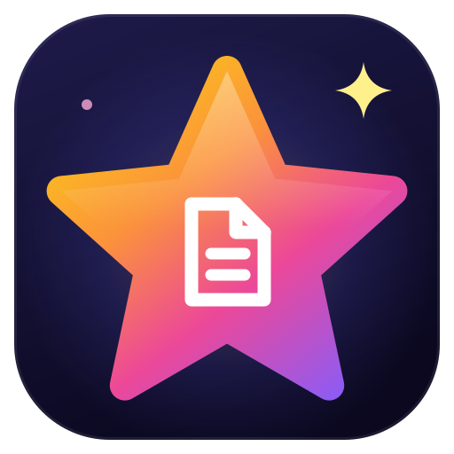

<p align="center">
  
</p>

<h1 align="center">NoteStar</h1>

<!-- badges:start -->
<p align="center">
  <a href="https://www.c64va.pro/notestar.html"></a>
  <a href="https://github.com/zstarczali/NoteStar/blob/main/package.json"></a>
  <a href="https://github.com/zstarczali/NoteStar/actions/workflows/build.yml"></a>
  <a href="https://github.com/zstarczali/NoteStar/blob/main/LICENSE"></a>
  <a href="https://www.c64va.pro/register/donate.php"></a>
</p>
<p align="center">
  <a href="https://v2.tauri.app/"></a>
  <a href="https://www.rust-lang.org/"></a>
  <a href="https://www.c64va.pro/notestar.html"></a>
  <a href="https://github.com/zstarczali/NoteStar/commits/main"></a>
  <a href="https://github.com/zstarczali/NoteStar/graphs/commit-activity"></a>
  <a href="https://github.com/zstarczali/NoteStar/issues"></a>
  <a href="https://github.com/zstarczali/NoteStar/stargazers"></a>
</p>
<p align="center">
  <a href="https://github.com/zstarczali/NoteStar#readme"></a>
  <a href="https://github.com/zstarczali/NoteStar#readme"></a>
  <a href="https://github.com/zstarczali/GitStar"></a>
  <a href="https://github.com/zstarczali/FtpStar"></a>
  <a href="https://github.com/zstarczali/DiffStar"></a>
</p>
<!-- badges:end -->

NoteStar keeps plain text / Markdown notes in sync between your computers through **OneDrive, Dropbox, WebDAV or any synced folder**, with a **Tauri 2 and Rust** backend. It is the sibling of [GitStar](https://github.com/zstarczali/GitStar), [FtpStar](https://github.com/zstarczali/FtpStar) and [DiffStar](https://github.com/zstarczali/DiffStar) and shares their themes, dialogs and AI setup.

Current version **0.3.6**. See [What's new](whatsnew.txt) for the release history.

## Features

- **Plain files** — Every note is an ordinary `.md` / `.txt` file in the notes folder (default `Documents/NoteStar`), in any folder structure. Any other editor can open them.
- **Editor** — Edit, split (editor + live preview) or preview mode; autosave; list continuation on Enter, Tab / Shift+Tab indenting list items, Ctrl+B / Ctrl+I, find in note, clickable task boxes (`- [ ]`) in the preview, links opened in the browser.
- **Notes tree** — Folders, sorting by name or last change, drag and drop to move notes and folders, rename, delete to the recycle bin, show in folder, open with another program.
- **Stars and colours** — Star notes (Ctrl+D) to keep them on top of the tree, and mark them with one of seven colours. Both sync to your other machines.
- **Full-text search** in every note (Ctrl+Shift+F) with highlighted snippets; a hit opens at its line.
- **Sync targets** (any number, each two-way):
  - **Folder** — any folder, typically the folder of a cloud desktop client (OneDrive, Dropbox, Google Drive, iCloud — detected automatically), a network drive or a USB disk.
  - **OneDrive** through Microsoft Graph with **your own App ID** (Azure app registration, device-code sign-in, no secret).
  - **Dropbox** through the Dropbox API with **your own App key** (OAuth PKCE, no secret).
  - **WebDAV** — Nextcloud, ownCloud, Synology, Apache…
- **Safe sync** — Three-way comparison with the state of the previous sync: new, changed and deleted notes go both ways. A note changed on both sides is never lost: the other version is saved as a *conflict copy* next to it. A sync that would delete many files stops and asks; a changed notes folder or remote address starts a fresh, merge-only sync; local deletions go to the recycle bin. Automatic sync at start, after saving and every N minutes.
- **Optional AI** (off by default, **Settings → AI**) — summary, spelling and grammar fixes, rewriting, translation, task extraction; the result can replace the note or be inserted at the cursor. **AI merge** turns a sync conflict copy and its original into one note. Only the current note is sent, and only when you ask.
- **Themes** — Dark, light, AI neon, retro, modern, modern dark, or system, as in GitStar. Zoom with Ctrl + / Ctrl − / Ctrl 0.
- **Self-update** — Looks for a newer installer in `downloads/NoteStar/` on the update server (default `https://www.c64va.pro/`).
- **English and Hungarian** interface.

## Running from source

Install stable Rust and Node.js. On Windows, WebView2 is required and comes with Windows 11. On Linux, install the Tauri system dependencies, including WebKitGTK 4.1.

```bash
npm install
npm run dev
```

To build an NSIS installer locally on Windows (written to `src-tauri/target/release/bundle`):

```bash
npm run build -- --bundles nsis
```

Tests of the sync engine, the providers and the notes module: `cd src-tauri && cargo test`.

### Building installers with GitHub Actions

The `.github/workflows/build.yml` workflow runs **only when manually triggered** (**Actions → Build installers → Run workflow**). It builds Windows x64 / ARM64 (NSIS), macOS ARM64 / x64 (`.dmg`) and Linux x64 (`.deb`, `.rpm`, `.AppImage`) installers. **Actions → Publish** uploads them, plus `readme.txt`, `whatsnew.txt` and `LICENSE`, to `/www/downloads/NoteStar/` over FTPS; it needs the **FTP_PASSWORD** Actions secret.

## Sync setup

**Settings → Sync → New sync target…**

- **Folder** — pick the folder or click a detected cloud folder (a `NoteStar` subfolder is suggested). It cannot be the notes folder itself, nor inside or above it.
- **OneDrive** — in the [Azure Portal](https://portal.azure.com/#view/Microsoft_AAD_RegisteredApps/ApplicationsListBlade) create an app registration (account types: include personal Microsoft accounts), set **Authentication → Allow public client flows = Yes**, add the delegated Microsoft Graph permissions `Files.ReadWrite`, `offline_access`, `User.Read`. Paste the **Application (client) ID**, click **Sign in** and enter the shown code at microsoft.com/devicelogin.
- **Dropbox** — in the [App Console](https://www.dropbox.com/developers/apps) create a *Scoped access* app (*App folder* or *Full Dropbox*) with `files.metadata.read`, `files.content.read`, `files.content.write`, `account_info.read`. Paste the **App key**, click **Sign in**, allow access in the browser and paste the code back.
- **WebDAV** — the server address (Nextcloud: *Files → Settings → WebDAV*), user and password (an app password with two-factor sign-in).

Tokens, passwords and API keys are stored unencrypted in `settings.json` in the app configuration folder (on Windows `%APPDATA%\hu.notestar.app\settings.json`); the sync state of each target is in `sync/<id>.json` next to it.

## AI setup

Turn on **Settings → AI → Turn on the AI features**, then choose **Anthropic Claude (API key)**, **Claude Code CLI (your own login)** or **DeepSeek** — the same options as in GitStar. When off, NoteStar contacts no AI provider and shows no AI buttons.

## Keyboard shortcuts

| Shortcut | Action |
|---|---|
| Ctrl+N / Ctrl+Shift+N | New note / new folder |
| Ctrl+S | Save now (otherwise automatic) |
| Ctrl+E | Toggle edit / preview |
| Ctrl+F / Ctrl+Shift+F | Find in note / search all notes |
| Ctrl+B / Ctrl+I | Bold / italic |
| F2 | Rename the note |
| F5 | Sync now |
| Ctrl+Shift+A | AI assistant (when on) |
| Ctrl+W, Ctrl+Tab | Close tab, next tab |
| Ctrl+, / F1 | Settings / About |

## Project structure

```text
src-tauri/src/
  notes.rs      Notes folder: list, read, atomic write, create, rename, recycle bin, search
  sync.rs       Three-way sync engine, sync state, conflict copies, mass-delete guard
  remote.rs     Sync target abstraction + local folder target
  onedrive.rs   Microsoft Graph (device-code sign-in)
  dropbox.rs    Dropbox API v2 (PKCE sign-in)
  webdav.rs     WebDAV (PROPFIND / PUT / MKCOL / DELETE)
  ai.rs         AI API calls and prompts (claude_cli.rs: Claude Code CLI)
  commands.rs   Tauri commands
  update.rs     Self-update
www/js/
  app.js        Tabs, toolbar, welcome page, settings, AI panel, about, update, sync schedule
  notes.js      Notes tree, editor (formatting toolbar, images), preview
  markdown.js   Markdown → safe HTML (marked + DOMPurify, footnotes, ==highlight==)
www/vendor/     marked 18.2.0 (MIT) and DOMPurify 3.4.18 (Apache-2.0 / MPL-2.0)
  sync.js       Sync target dialogs, sign-in flows, running the sync
  i18n.js, i18n-en.js  Hungarian → English translations
```

## License

NoteStar is free and open source under the MIT License, © 2026 Zsolt Tarczali. See [LICENSE](LICENSE). The bundled third-party libraries in `www/vendor/` keep their own licenses (`LICENSE-marked.md`, `LICENSE-dompurify.txt`).

If NoteStar is useful to you, you can support its development with a small [donation](https://www.c64va.pro/register/donate.php).

© 2026 Zsolt Tarczali
